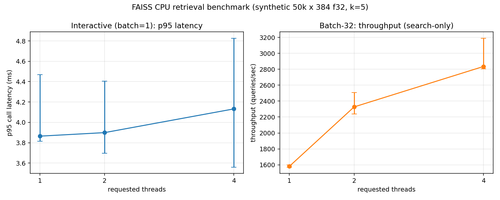

# FAISS CPU Retrieval Benchmark (synthetic workload)

A small, reproducible FAISS CPU retrieval benchmark run on a Lenovo
Legion laptop. **The workload is synthetic**: no HyArg artifacts were
supplied, so the dataset is seeded Gaussian vectors.

## Benchmark question

On this CPU, with an `IndexFlatL2` of 50,000 x 384-D float32 vectors and
`k=5`:

1. **Interactive use case (batch=1)** — which of 1, 2, or 4 requested
   OpenMP threads gives the lowest p95 per-call search latency?
2. **Throughput use case (batch=32)** — which gives the highest
   throughput when 32 queries are already waiting?

Same index, same queries, same k. Two different metrics for two
different operating points.

## Fresh results



From the fresh full run in `runs/20261107T032705Z-full-6604f72/`
(30 per-call records; 6 configs x 5 reps; manifest-checked; agreement 1.000
across every rep).

### Interactive (batch=1): p95 per-call latency (ms)

| threads | median p95 | min    | max    | % vs 1-thread median |
|---------|------------|--------|--------|----------------------|
| 1       | 3.864      | 3.814  | 4.469  | —                    |
| 2       | 3.899      | 3.696  | 4.405  | +0.9%                |
| 4       | 4.132      | 3.560  | 4.825  | +6.9%                |

### Throughput (batch=32): queries/sec (search-only; see "Timing" below)

| threads | median qps | min    | max    | % vs 1-thread median |
|---------|------------|--------|--------|----------------------|
| 1       | 1581.9     | 1571.8 | 1599.2 | —                    |
| 2       | 2326.9     | 2237.8 | 2507.7 | +47.1%               |
| 4       | 2834.4     | 2803.0 | 3186.7 | **+79.2%**           |

### Decision rule and recommendation (from `recommendations.json`)

**Rule.** A thread count is a "clear winner" for a use case only if its
median is outside the `[min, max]` range of every other measured
thread count in this run. This is a descriptive overlap check, **not a
formal significance test**.

- **Interactive:** `no_clear_winner`. The best median is at t=1
  (3.864 ms), but its own range `[3.814, 4.469]` overlaps the ranges
  for t=2 and t=4. Rank order was unstable across reps. Default
  recommendation: **1 thread** (matches the measured median; nothing
  else is distinguishable at this sample size).
- **Throughput:** `clear_winner` at **4 threads**. Its min (2803 qps)
  exceeds the maxes of both t=1 (1599) and t=2 (2508). +79.2% over the
  single-thread batch-32 baseline.

These recommendations are **limited to the measured configurations and
workload**: threads in {1, 2, 4}, batch sizes in {1, 32}, this
IndexFlatL2 over 50k x 384 f32 vectors with k=5, on the specific CPU
and power state recorded in `machine.json`.

### Agreement with the reference

For every `(threads, batch, rep)`, the top-5 ID set was compared to the
`(threads=1, batch=1, same rep)` run on the same queries, outside the
timed region. Across all 30 records: **1.000 min, 1.000 median,
1.000 max fraction identical**.

Floating-point summation is non-associative, so parallel reductions
across different thread counts **can** produce slightly different
distances and could, in principle, change which ID wins near a tie.
This run exhibited no such differences; we report the observed agreement
rather than a correctness guarantee.

### Fresh vs historical comparison

Historical measurements are preserved in `results/` (from commit
`6604f72`). To make the comparison apples-to-apples, the historical
throughput numbers below have been **recalculated from the historical
raw per-call data using the new `sum(call_durations_s)` denominator**;
the original run's reported throughput used a near-equivalent
elapsed-around-loop denominator and differs by less than 0.1%.

| metric             | historical (recalc) | fresh         | delta   |
|--------------------|---------------------|---------------|---------|
| p95 t=1 (ms)       | 3.921               | 3.864         | -1.5%   |
| p95 t=2 (ms)       | 3.962               | 3.899         | -1.6%   |
| p95 t=4 (ms)       | 3.883               | 4.132         | +6.4%   |
| qps t=1            | 1509.0              | 1581.9        | +4.8%   |
| qps t=2            | 2229.1              | 2326.9        | +4.4%   |
| qps t=4            | 2757.7              | 2834.4        | +2.8%   |

Observations about the deltas, not tuning decisions:

- Throughput is uniformly higher on the fresh run (~3–5%). Plausible but
  unverified causes: different thermal/boost state, background process
  load, battery charging profile. We did not measure CPU frequency or
  power draw to confirm.
- Interactive p95 at t=4 moved up enough that the fresh "best median"
  flipped from t=4 (historical) to t=1 (fresh). Both runs agree on the
  bigger finding: **batch=1 differences across thread counts are within
  run-to-run variability** — the rank order is not stable, which is
  exactly why the rule returns `no_clear_winner`.

No parameters were changed between the two runs to force this picture.

## Experiment protocol

- **Dataset.** `scripts/make_data.py` writes `data/xb.npy`
  (50,000 x 384 f32, seed 20261106) and `data/xq.npy` (512 x 384 f32,
  seed 20261107). Dataset identity is enforced per-run: the manifest
  records SHA-256 of both files and every worker re-hashes the files
  and refuses to run if a hash differs.
- **Index.** `faiss.IndexFlatL2(384)` with `index.add(xb)` built fresh
  in every worker (outside the timed region).
- **Configurations.** `(threads, batch_size) in {(1,1), (2,1), (4,1),
  (1,32), (2,32), (4,32)}`, 5 reps each. 512 queries per (config, rep).
  Query order per rep is a deterministic permutation keyed by
  `(seed, rep)`; the same order is used by all six configs within a
  rep.
- **Process isolation.** Every (config, rep) runs in a fresh Python
  subprocess spawned by `scripts/run_bench.py`. Before the worker
  imports NumPy/FAISS, the orchestrator sets
  `OMP_NUM_THREADS`, `MKL_NUM_THREADS`, `OPENBLAS_NUM_THREADS`,
  `VECLIB_MAXIMUM_THREADS`, `NUMEXPR_NUM_THREADS`, and
  `BLIS_NUM_THREADS` to the requested count. After import, the worker
  calls `faiss.omp_set_num_threads(threads)` and records
  `threadpool_info()` from `threadpoolctl` for the loaded BLAS/OMP
  runtimes.
- **Run isolation.** Every experiment writes to its own directory under
  `runs/<timestamp>-<mode>-<git short>/`. A smoke run cannot overwrite
  a full run (and vice versa).
- **Timing.** Only `index.search()` calls are timed, with
  `time.perf_counter()`. Two timing fields are recorded per worker:
    - `sum_call_durations_s` — sum of per-call durations. **This is the
      denominator for throughput.** Python overhead between calls is
      excluded.
    - `elapsed_around_loop_s` — wall time from the first call's `t0` to
      the last call's `t1`. Kept as a **diagnostic** (always >=
      `sum_call_durations_s`). Not used in headline metrics.
- **Agreement.** After the timed region, each worker makes a separate,
  untimed pass over the same queries to collect top-5 IDs. Analysis
  compares every record to the same-rep `(threads=1, batch=1)` run and
  fails if any required reference is missing.
- **Validation before publishing.** `analyze.py` reads exactly one run
  directory, validates the manifest against actually-present records
  (missing, duplicates, extras), re-validates every record's shape and
  timing values, and refuses to produce a summary for an incomplete
  full run.

## Hardware and software (fresh run)

Recorded in `runs/<run_id>/machine.json` and per-worker records:

- **CPU:** Intel(R) Core(TM) i9-14900HX, 24 physical cores / 32 logical
  processors (hybrid P-core + E-core). WMI base clock: 2200 MHz.
- **OS:** Microsoft Windows 11 Home, build 10.0.26300. Native Windows,
  not WSL.
- **Memory:** ~15.73 GiB visible.
- **Power:** on AC, plan "Balanced", battery charging across the run.
- **Python:** 3.11.9.
- **Packages:** faiss-cpu 1.8.0, numpy 1.26.0, matplotlib 3.10.3,
  threadpoolctl 3.6.0.
- **Runtime pools (threadpoolctl, with threads=4 example):**
  OpenBLAS 0.3.23 (num_threads=4), two libomp libraries loaded by FAISS
  (both num_threads=4). The configured limits propagated to the actual
  loaded runtimes.
- **Not measured, explicitly:** actual achieved CPU frequency during the
  run, P-core vs E-core placement of worker threads, cache utilisation,
  memory bandwidth, energy/power in watts, and achieved CPU utilisation
  percentage. These are captured as `null` with a reason in
  `machine.json` under `measured_during_run`.

## Reproducing

All commands below are PowerShell on Windows (the environment that
produced these results). The regression tests also pass under `bash`
using the same Python interpreter.

### 1. Isolated environment and install

```powershell
python -m venv .venv
.\.venv\Scripts\Activate.ps1
python -m pip install --upgrade pip
pip install -r requirements.txt
```

If pip fails with an SSL certificate error on Windows Store Python,
re-run with:

```powershell
pip install --trusted-host pypi.org --trusted-host files.pythonhosted.org -r requirements.txt
```

### 2. Build the seeded dataset (once)

```powershell
python scripts\make_data.py
```

### 3. Smoke run (one config, one rep)

```powershell
python scripts\run_bench.py --mode smoke
python scripts\analyze.py --run-dir (Get-ChildItem runs\*-smoke-* -Directory | Sort-Object Name -Descending | Select-Object -First 1).FullName
```

### 4. Full run (6 configs x 5 reps) and analysis

```powershell
python scripts\run_bench.py --mode full --reps 5
python scripts\analyze.py --run-dir (Get-ChildItem runs\*-full-* -Directory | Sort-Object Name -Descending | Select-Object -First 1).FullName
```

To analyse a specific prior run:

```powershell
python scripts\analyze.py --run-dir runs\20261107T032705Z-full-6604f72
```

### 5. Regression tests

```powershell
python tests\test_regression.py
```

All 16 checks must pass. The tests cover: smoke end-to-end, smoke/full
separation, incomplete-full detection, mismatched query/ID arrays,
throughput formula, and decision-rule consistency.

## Repository layout

```
faiss-cpu-benchmark/
  README.md
  requirements.txt
  .gitignore
  scripts/
    inspect_machine.py   per-run machine metadata (explicit unknowns)
    make_data.py         seeded synthetic dataset
    worker.py            single-config worker; writes one JSON per run
    run_bench.py         orchestrator (modes, manifest, status)
    analyze.py           reads ONE run dir; validates then summarises
    validate.py          shared validators (also imported by tests)
  tests/
    test_regression.py   runnable: `python tests/test_regression.py`
  data/
    dataset.json         dataset metadata (.npy files are gitignored and
                         regenerated deterministically by make_data.py)
  runs/
    <timestamp>-<mode>-<git short>/
      manifest.json      what was planned; git, versions, hashes
      machine.json       hardware/software/power at inspection
      run_order.json     actual run order + wall times
      per_call/*.json    one raw record per (config, rep)
      summary.csv        per-run metrics
      summary_agg.csv    median [min, max] per config
      agreement.json     per-rep top-5 identity
      recommendations.json
      figure.png
      status.json        completion state and any gaps
      analysis_notes.json which comparisons were performed
  results/               HISTORICAL run from commit 6604f72 (preserved)
```

## Limitations

- Synthetic standard-normal data only. A real HyArg index with different
  distribution, cardinality, or dimensionality may behave differently.
- `IndexFlatL2` is an exact brute-force index. Results do not transfer
  directly to `IndexIVFPQ`, `HNSW`, or other approximate indexes.
- Only threads in {1, 2, 4} and batch sizes {1, 32} were tested. 8/16
  threads and larger batches may change the picture, especially on a
  24-core CPU.
- The decision rule is a descriptive range-overlap check, not a formal
  statistical test. With 5 reps, confidence intervals are not a
  substitute for a larger experiment if you need tighter conclusions.
- Hardware counters (cycles, instructions, cache miss rates, memory
  bandwidth, RAPL energy) and actual CPU utilisation were **not
  measured**. Explanations invoking cache, P-core/E-core placement, or
  memory bandwidth would be hypotheses, not findings from this run.

## What was and was not verified by the latest run

- **Verified by `runs/20261107T032705Z-full-6604f72/`:** 30 per-call
  records written; manifest-vs-records check returned `state=completed`;
  every record's dataset SHA-256 matched the manifest; every record's
  configured OpenMP limit and `faiss.omp_get_max_threads()` matched the
  requested thread count; `threadpoolctl` confirmed OpenBLAS and both
  libomp runtimes honoured the configured thread cap; agreement check
  ran against a per-rep reference for every non-reference record.
- **Verified by `tests/test_regression.py`:** smoke end-to-end,
  smoke/full isolation, incomplete-full detection by `analyze.py`,
  record-shape validation, throughput formula, decision-rule
  consistency.
- **Not verified:** actual CPU frequency and boost state during timing,
  P-core/E-core placement, cache/memory-bandwidth behaviour, energy,
  achieved CPU utilisation percentage, and any claim about **why** the
  observed scaling is what it is. These are explicitly documented as
  unknown in `machine.json`.
