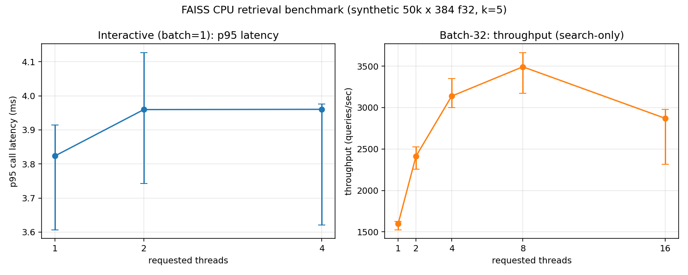

# FAISS CPU Retrieval Benchmark (synthetic workload)

A small, reproducible FAISS CPU retrieval benchmark on a Lenovo Legion
laptop (Intel Core i9-14900HX, Windows 11 native). The workload is a
**synthetic** `IndexFlatL2` of 50,000 x 384-D float32 vectors with
seeded Gaussian queries (512 held-out queries, k=5) — described in
full under [Experiment protocol](#experiment-protocol). Headline
numbers below are search-only `time.perf_counter()` measurements from
per-process workers, 5 repetitions each, deterministically shuffled
order, manifest-validated.

## Benchmark questions

On this CPU, with that index and k:

1. **Interactive (batch=1)** — which of 1, 2, or 4 requested OpenMP
   threads gives the lowest p95 per-call search latency? (unchanged
   historical experiment)
2. **Throughput scaling (batch=32)** — which of 1, 2, 4, 8, or 16
   requested threads gives the highest throughput when 32 queries are
   already waiting? Does scaling continue, plateau, or regress?
3. **P-core vs E-core placement** — at 4 requested threads, how does
   restricting the process to 4 physical P-cores or 4 physical E-cores
   compare to the default scheduler?

## Headline results



### Thread scaling (batch=32, search-only throughput, qps)

From `runs/20261107T064707Z-full-8b401ae/` (commit `8b401ae`, source
clean, 40/40 records; agreement 1.000 across every rep):

| threads | median qps | min    | max    | speedup | parallel eff. | % vs 1t |
|---------|------------|--------|--------|---------|---------------|---------|
| 1       | 1600.4     | 1525.4 | 1625.4 | 1.00x   | 1.00          | —       |
| 2       | 2413.6     | 2255.5 | 2525.9 | 1.51x   | 0.75          | +50.8%  |
| 4       | 3138.0     | 3002.2 | 3349.6 | 1.96x   | 0.49          | +96.1%  |
| 8       | **3492.2** | 3172.9 | 3661.4 | 2.18x   | 0.27          | +118.2% |
| 16      | 2870.1     | 2318.1 | 2981.1 | 1.79x   | 0.11          | +79.3%  |

**Scaling judgment: `regression`.** Throughput rises from 1 to 8
threads, then drops at 16 threads. Scaling efficiency falls monotonically
from 1.00 to 0.11. The best observed configuration is **8 threads**.

### Interactive (batch=1): p95 per-call latency (ms)

| threads | median p95 | min    | max    | % vs 1-thread |
|---------|------------|--------|--------|---------------|
| 1       | 3.823      | 3.607  | 3.914  | —             |
| 2       | 3.960      | 3.743  | 4.126  | +3.6%         |
| 4       | 3.960      | 3.621  | 3.976  | +3.6%         |

**Decision: `no_clear_winner`.** The best median is t=1 (3.823 ms) but
t=1's own range `[3.607, 3.914]` overlaps both t=2 and t=4 medians.
With 5 reps the between-thread effect is within per-rep noise.

### P-core vs E-core placement (batch=32, 4 requested threads)

From `runs/20261107T080151Z-pe2-11793f1/`, commit `11793f1`,
source clean, **10 interleaved repetitions**, one measurement per
placement per rep in a shuffled order. 120 per-call records total
(10 reps × 3 placements × 4 configs) across three sub-runs. Status
`completed` and **0 affinity mismatches** in every sub-run.

Topology (from `scripts/topology.py` via
`GetLogicalProcessorInformationEx`): 8 physical P-cores exposed as
logical CPUs 0..15 (SMT), 16 physical E-cores as logical CPUs 16..31
(no SMT), `EfficiencyClass` 1 vs 0.

Power state (from `power_state.json`): AC power, "Balanced" plan,
battery at 100% at both start and end of the run.

| placement            | median qps | min   | max    | per-rep qps (10) |
|----------------------|------------|-------|--------|------------------|
| default scheduler    | 3085.6     | 2969.1 | 3279.0 | 3080, 3073, 3037, 3138, 3279, 3185, 3267, 2969, 3091, 3064 |
| 4 physical P-cores   | **3283.3** | 3115.4 | 3468.6 | 3200, 3273, 3115, 3265, 3267, 3357, 3469, 3294, 3294, 3397 |
| 4 physical E-cores   | 956.3      | 353.5  | 1411.2 | 354, 1236, 456, 1077, 1411, 528, 1019, 667, 1229, 894 |

Headline ratio (medians): **P-cores / E-cores ≈ 3.43x**. This
supersedes the preliminary 2.66x figure from the older 5-rep
back-to-back run (`runs/20261107T071454Z-pe-9f2ab32/`, preserved).

Observations:

- P-core and default-scheduler per-rep ranges tightened vs the 5-rep
  v1 run (no outliers), consistent with interleaving removing the
  back-to-back cold-start bias v1 exhibited.
- E-core per-rep throughput remains highly variable (353–1411 qps,
  factor of 4 between min and max) **even with interleaving**. The
  median (956 qps) is more robust across 10 reps, but we are
  reporting the full range for honesty.
- The default-scheduler median (3086 qps) is close to the 4-P-core
  median (3283 qps), both well above the 4-E-core median. What the
  default scheduler actually did with the 4 worker threads on this
  machine was **not measured**; a VTune Hotspots `by_cpu` table is
  the direct way to establish it (see `docs/VTUNE_COMMANDS.md`).
- Observed `cpu_affinity.observed_cpu_ids` matched the requested set
  in every per-call record of the P- and E-core sub-runs
  (`affinity_check.mismatches == 0`).

### Why 16 threads regressed — VTune evidence

**Observation (scaling):** throughput peaks at 8 threads and drops
~18% at 16 threads.

**Observation (P/E, v2):** on 4 physical E-cores the same workload
runs ~3.43x slower than on 4 physical P-cores. This is a property of
the per-core work rate on this CPU, not by itself an explanation of
the scaling curve at 16 threads.

**Observation (VTune, `runs/20261107T012857Z-vtune-hotspots-f085a13/`):**
Hotspots collections at 1, 4, 8, 16 threads with the measured region
ITT-gated (`PROFILE_REGION_START/END`, `-start-paused`, `Paused Time`
17–20 s in each run confirms setup/warm-up was excluded). Key totals
across the measured region:

| threads | CPU Time | Effective Time | Spin Time | Overhead | Total threads |
|---------|---------:|---------------:|----------:|---------:|--------------:|
| 1       |  24.6 s  | 24.56 s        |  0.01 s   | 0.08 s   | 8             |
| 4       |  74.0 s  | 19.93 s        | 52.60 s   | 1.45 s   | 17            |
| 8       | 119.0 s  | 16.90 s        |100.36 s   | 1.78 s   | 29            |
| 16      | 209.6 s  | 32.24 s        |173.74 s   | 3.64 s   | 53            |

Top hotspots at every multi-threaded count are **`SwitchToThread`**
(KERNELBASE.dll), **`WaitForSingleObjectEx`** (KERNELBASE.dll), and a
**`libomp140` spin function** — all three are OMP barrier / kernel
wait, not search work. At 16 threads these three add up to ~81 % of
total CPU time, with the productive work (`sgemm_kernel_HASWELL` +
`sgemm_incopy_HASWELL` in OpenBLAS) only ~6 %.

Per-thread breakdown at 16 threads (`hs_t16/per_thread.csv`): all 16
worker threads do essentially identical CPU work (~9.3 s each,
~1.6 s effective + ~7.7 s spin). There is **no slow-thread outlier**
that would indicate some workers landed on E-cores and dragged a
barrier. Work distribution across workers is balanced.

**What the VTune evidence establishes:**

- The 16-thread regression is dominated by **OMP synchronization /
  spin time**, which scales near-linearly in CPU-time with thread
  count while effective (productive) CPU time does not.
- "FAISS at 16 threads necessarily spills onto E-cores" is **not
  supported** by this evidence. With balanced per-thread CPU
  distribution, a mix of fast and slow cores would produce a visible
  imbalance in effective-time per thread; we see none.
- The compute itself is **OpenBLAS `sgemm_kernel_HASWELL`** — the
  Haswell-AVX2 kernel. **AVX2 is the widest vector ISA this CPU
  supports:** the i9-14900HX is Raptor Lake Refresh, which (like
  Raptor Lake, 13th gen) has no AVX-512 support on the P-cores or
  E-cores. The Haswell-AVX2 sgemm kernel is therefore the expected
  code path for `sgemm` on this CPU, not a suboptimal fallback.

**What is still unresolved:**

- Whether the OS scheduler actually placed the 16 OMP workers across
  P and E cores. The `-report hw-events -group-by=cpu` table requires
  hardware-counter sampling (uarch-exploration), which needs the
  VTune kernel sampling driver + admin and is **not available** on
  this install (`vtune: Warning: Microarchitecture performance
  insights will not be available. Make sure the sampling driver is
  installed and enabled on your system`). The exported `by_cpu.csv`
  files are consequently empty.
- Whether running with `KMP_BLOCKTIME=0` or thread binding
  (`OMP_PROC_BIND=close`) would reduce the observed spin time. Not
  tested.

**Important correction to earlier wording.** This machine's 8 P-cores
expose **16 logical processors via SMT**, so 16 OpenMP threads can
fit on P-cores alone (two threads per physical core, SMT siblings).
"16 threads necessarily spill onto E-cores" is **not** supported by
the available topology data and has been removed. Candidate
mechanisms for the 16-thread regression that remain live:

- SMT contention: two logical threads sharing one P-core's physical
  execution units can contend for L1/L2 cache, FP units, and memory
  controllers.
- E-core placement by the OS scheduler: under default affinity the
  kernel may still place some workers on E-cores even when SMT
  capacity exists.
- OMP thread-management overhead (barriers, work distribution) at
  higher thread counts.

**Which of these actually dominates was investigated with VTune
Hotspots at 1/4/8/16 threads** (see the "Why 16 threads regressed"
section below for the finding and evidence). VTune
Microarchitecture Exploration and `-group-by=cpu` placement evidence
were **not** collected because this consumer SKU + non-admin install
lacks the VTune kernel sampling driver; see Stage 2/3 status below
and `docs/VTUNE_COMMANDS.md`.

## Historical results preserved

| commit    | run dir                                        | note                                                |
|-----------|------------------------------------------------|-----------------------------------------------------|
| 6604f72   | `results/`                                     | original run, legacy schema                         |
| 6604f72   | `runs/20261107T032705Z-full-6604f72/`          | re-analysed under schema 2 (same data)              |
| 2f23831   | `runs/20261107T042639Z-full-2f23831/`          | validated schema-2 full run, 3-thread set           |
| 8b401ae   | `runs/20261107T064707Z-full-8b401ae/`          | 5-thread scaling (1,2,4,8,16)                       |
| 9f2ab32   | `runs/20261107T071454Z-pe-9f2ab32/`            | P/E experiment v1 (5 reps, sequential, preserved)   |
| 11793f1   | `runs/20261107T080151Z-pe2-11793f1/`           | P/E experiment v2 (10 reps, interleaved)            |
| f085a13   | `runs/20261107T012857Z-vtune-hotspots-f085a13/`| **VTune Hotspots @ 1/4/8/16 threads**               |

The historical 3-thread runs are still accepted by the current
analyser without modification; new runs add two threads at the top
and the P/E experiment.

## Stage 2/3: Intel VTune collection — *Hotspots completed*

**Installed:** Intel VTune Profiler 2025.3.0 via the oneAPI Base
Toolkit (`winget install Intel.OneAPI.BaseToolkit`). ITT runtime at
`C:\Program Files (x86)\Intel\oneAPI\vtune\latest\bin64\runtime\ittnotify_collector.dll`.
`scripts/profile_workload.py` loads it via ctypes and calls
`__itt_resume` / `__itt_pause` to delimit the measured region.

**Hotspots collected** at 1, 4, 8, 16 threads
(`runs/20261107T012857Z-vtune-hotspots-f085a13/`). Exported
`summary.csv`, `hotspots.csv`, `per_thread.csv`, and
`workload_summary.json` are committed; raw VTune capture directories
(config/, data.0/, log/, sqlite-db/) are gitignored. See the "Why 16
threads regressed" section above for the primary finding
(OMP spin time dominates; no E-core imbalance in per-thread data).

**Microarchitecture Exploration not collected** — this consumer SKU
lacks the VTune kernel sampling driver and admin privileges needed
for hardware-event sampling. VTune emitted `Warning:
Microarchitecture performance insights will not be available. Make
sure the sampling driver is installed and enabled on your system.`
We treat that as "unavailable on this host" rather than inferring the
value.

### Remaining VTune work

Everything needed is implemented and documented:

- **Workload:** `scripts/profile_workload.py` runs the same batched
  search in a tight loop for a configurable wall-clock duration
  (default 25 s). Data load, index build, and 10 warm-up calls are
  **outside** the measured region. The region is delimited with
  sentinel prints (`PROFILE_REGION_START` / `PROFILE_REGION_END`)
  and, if the ITT API is importable, with
  `itt.task_begin/task_end` markers.
- **Baseline-throughput verification:** `profile_workload.py` runs
  without any profiler produce throughput numbers that match the
  per-process benchmark (1 thread: 1603 qps vs 1600, 4 threads:
  3174 vs 3138, 8 threads: 3408 vs 3492; see
  `runs/20261107T070000Z-profile-8b401ae/profile_t*.json`). The
  workload is therefore stable and ready for profiler attachment.
- **Exact collection commands** for Hotspots, Microarchitecture
  Exploration, and Performance Snapshot are in
  `docs/VTUNE_COMMANDS.md`, including matched-work interpretation
  guidance (fixed-duration runs process different query counts; totals
  must be normalised per query before cross-run comparison).

To unblock Stages 2/3, install VTune (free), then run the commands in
`docs/VTUNE_COMMANDS.md`. The expected outputs for commit comparison
are `summary.csv`, `hotspots.csv`, `callstacks.csv`, and
`workload_summary.json` per thread count.

## Experiment protocol

- **Dataset.** `scripts/make_data.py` writes `data/xb.npy`
  (50,000 x 384 f32, seed 20261106) and `data/xq.npy` (512 x 384 f32,
  seed 20261107). Dataset identity is enforced per-run: the manifest
  records SHA-256 of both files and every worker re-hashes and refuses
  to run on drift.
- **Index.** `faiss.IndexFlatL2(384)` with `index.add(xb)`, built fresh
  in every worker (outside the timed region).
- **Configurations (default full run).** `(threads, batch_size)` =
  `{(1,1),(2,1),(4,1), (1,32),(2,32),(4,32),(8,32),(16,32)}`, 5 reps each.
  `--threads-batch1` and `--threads-batch32` make these sets
  configurable; manifests enumerate exactly the chosen set.
- **Queries.** Same 512 distinct queries used in every (config, rep).
  Query order per rep is a deterministic permutation keyed by
  `(seed, rep)`; the same order is applied by every config within a
  rep. Query count was **not increased** for this extension — the
  observed per-rep ranges at every thread count stayed within the same
  envelope as the 3-thread historical runs, so the measured duration
  is sufficient for the comparisons we are making. Had we increased
  the query count, it would have been applied uniformly and labelled
  as a new protocol.
- **Process isolation.** Every (config, rep) runs in a fresh Python
  subprocess spawned by `scripts/run_bench.py`. Before the worker
  imports NumPy/FAISS, the orchestrator sets `OMP_NUM_THREADS`,
  `MKL_NUM_THREADS`, `OPENBLAS_NUM_THREADS`, `VECLIB_MAXIMUM_THREADS`,
  `NUMEXPR_NUM_THREADS`, and `BLIS_NUM_THREADS` to the requested
  count. After import, the worker calls
  `faiss.omp_set_num_threads(threads)` and records `threadpool_info()`
  from `threadpoolctl` for the loaded BLAS/OMP runtimes.
- **CPU affinity (P/E experiment).** `--cpu-affinity` is parsed by the
  worker **before** numpy/faiss import and applied via Windows
  `SetProcessAffinityMask`. Observed affinity (process-level mask) is
  read back via `GetProcessAffinityMask` and recorded per record.
  This is a **process-level restriction** on the set of CPUs the OS
  scheduler may use; it is not per-thread pinning (thread-to-core
  binding within the restricted set is still OS-controlled).
- **Timing.** Only `index.search()` calls are timed with
  `time.perf_counter()`. Two timing fields are recorded:
  - `sum_call_durations_s` — sum of per-call durations.
    **Throughput denominator.** Python overhead between calls is
    excluded.
  - `elapsed_around_loop_s` — wall from the first call's `t0` to the
    last call's `t1`. Diagnostic only; always >=
    `sum_call_durations_s`. Not used in headline metrics.
- **Agreement.** After the timed region, each worker makes a
  separate, untimed pass over the same queries to collect top-5 IDs.
  Analysis compares every record to the same-rep `(threads=1,
  batch=1)` run and fails if any required reference is missing.
- **Validation before publishing.** `analyze.py` runs all validation
  (manifest-vs-records, dataset identity hashes, timing-total
  consistency, nonfinite guards, agreement) **before any report
  artefact is written**. See `scripts/validate.py` and
  `tests/test_regression.py`.

## Hardware and software

Recorded in `runs/<run_id>/machine.json` and per-worker records:

- **CPU:** Intel(R) Core(TM) i9-14900HX, 24 physical cores / 32
  logical processors. **Hybrid: 8 P-cores (SMT, EfficiencyClass 1,
  logical CPUs 0–15), 16 E-cores (no SMT, EfficiencyClass 0, logical
  CPUs 16–31)**, verified by `scripts/topology.py`. WMI base clock
  2200 MHz; actual boost not measured.
- **OS:** Microsoft Windows 11 Home, build 10.0.26300. Native
  Windows, not WSL.
- **Memory:** ~15.73 GiB visible.
- **Power:** AC, plan "Balanced" during all runs.
- **Python:** 3.11.9.
- **Packages:** faiss-cpu 1.8.0, numpy 1.26.0, matplotlib 3.10.3,
  threadpoolctl 3.6.0, psutil 5.9.8.
- **BLAS/OMP runtimes (threadpoolctl at 4 threads):** OpenBLAS 0.3.23,
  two libomp libraries loaded by FAISS, all respecting the configured
  thread limit.
- **Explicitly not measured:** actual achieved CPU frequency and
  boost residency, cache utilisation, memory bandwidth,
  energy/power in watts, achieved CPU utilisation percentage, whether
  the OS scheduler placed workers on P- or E-cores under the
  **default** (unrestricted) sub-run. Any mechanism claim invoking
  these is a hypothesis. **No energy-per-query or
  performance-per-watt claims are made.**

## Reproducing

### 1. Isolated environment and install

```powershell
python -m venv .venv
.\.venv\Scripts\Activate.ps1
python -m pip install --upgrade pip
pip install -r requirements.txt
```

If pip fails with an SSL certificate error on Windows Store Python:

```powershell
pip install --trusted-host pypi.org --trusted-host files.pythonhosted.org -r requirements.txt
```

### 2. Build the seeded dataset (once)

```powershell
python scripts\make_data.py
```

### 3. Scaling run (batch-1 at 1/2/4 threads + batch-32 at 1/2/4/8/16)

```powershell
python scripts\run_bench.py --mode full --reps 5
python scripts\analyze.py --run-dir (Get-ChildItem runs\*-full-* -Directory | Sort-Object Name -Descending | Select-Object -First 1).FullName
```

To tune the thread sets:

```powershell
python scripts\run_bench.py --mode full --reps 5 `
    --threads-batch1 "1,2,4" --threads-batch32 "1,2,4,8,16"
```

### 4. Topology dump

```powershell
python scripts\topology.py --out runs\topology.json
```

### 5. P-core vs E-core experiment (three sub-runs, 5 reps each)

```powershell
python scripts\pe_experiment.py --reps 5 --threads 4
```

Writes a new `runs/<timestamp>-pe-<git short>/` with three sub-runs
and `comparison.json`.

### 6. Regression tests

```powershell
python tests\test_regression.py
```

All 47 checks must pass.

### 7. VTune profile collection

Installed VTune 2025.3.0 via `winget install Intel.OneAPI.BaseToolkit`.
Hotspots at 1/4/8/16 threads are already collected and committed in
`runs/20261107T012857Z-vtune-hotspots-f085a13/`. To reproduce or add
further analyses, see `docs/VTUNE_COMMANDS.md`.
Microarchitecture Exploration requires the VTune kernel sampling
driver (not available on this consumer-SKU + non-admin install).

## Repository layout (additions from this extension)

```
scripts/
  profile_workload.py    fixed-duration VTune-ready workload
  topology.py            P/E-core enumeration (GetLogicalProcessorInformationEx)
  pe_experiment.py       3-sub-run P/E comparison orchestrator
docs/
  VTUNE_COMMANDS.md      exact install + collect commands
runs/
  <ts>-full-<git>/       as before (scaling runs)
  <ts>-pe-<git>/         P/E experiment (topology.json, comparison.json,
                         three sub-runs)
  <ts>-profile-<git>/    unprofiled fixed-duration runs as a baseline
```

## Limitations and reproduction boundary

- Synthetic Gaussian data; `IndexFlatL2`. Approximate indexes
  (`HNSW`, `IndexIVFPQ`, …) are out of scope.
- Only threads in {1, 2, 4, 8, 16} and batch sizes in {1, 32}, 5 reps
  each (plus the P/E sub-runs at 4 threads). The decision rule is a
  descriptive range-overlap check, not a significance test.
- **Variability.** The P/E sub-runs show per-rep outliers (3–8x slower
  than typical). The medians support the P-core / E-core ratio, but
  min/max are wide. Likely candidates include OMP thread-pool
  recreation cost under affinity restriction and background OS load;
  **not measured**.
- **Scheduler placement under default (unrestricted) runs** is not
  observed. Interpretations like "the default scheduler puts threads
  on P-cores" are consistent with the data but not verified.
- Cross-platform byte-identical regeneration of `xb.npy` from seeds is
  **not established** (an independent reviewer on Linux reports a
  different xb SHA-256 while xq matches). On this Legion, regenerating
  from seeds produces byte-identical files to the committed hashes.
  The benchmark is reproducible given the original Legion-generated
  `.npy` files identified by the committed hashes (the `.npy` files
  themselves are gitignored and not distributed in the repo); every
  worker refuses to run if the dataset drifts.
- No hardware counters, cache/bandwidth, RAPL energy, or per-core
  frequency were collected. VTune Hotspots (user-mode sampling)
  **was** collected at 1/4/8/16 threads; VTune Microarchitecture
  Exploration (hardware-event sampling) was not, because the VTune
  kernel sampling driver is not available on this host.

## What this extension verified

- **Thread scaling, 1→16 threads at batch=32:** peak at 8 threads
  (+118% median vs 1 thread), regression at 16 threads (+79%,
  down from +118%). Scaling judgment labelled `regression`.
- **P-core vs E-core affinity at 4 threads (v2, 10 interleaved reps):**
  medians 3283 qps (P-cores) vs 956 qps (E-cores), ratio ~3.43x;
  default scheduler median 3086 qps. 0 affinity mismatches across
  120 per-call records. Full per-rep values and the preserved v1
  run are in the headline P/E section.
- **Topology discovery:** `GetLogicalProcessorInformationEx` cleanly
  separates 8 P-cores from 16 E-cores on this hybrid CPU; result is
  deterministic and testable.
- **VTune Hotspots at 1/4/8/16 threads with ITT-gated region:**
  spin / kernel-wait time scales near-linearly with thread count
  while effective (productive) CPU time does not; per-thread work
  distribution at 16 threads is balanced (no E-core imbalance
  signature); productive compute is OpenBLAS `sgemm_kernel_HASWELL`,
  which is the expected AVX2 kernel for this CPU (the i9-14900HX is
  Raptor Lake Refresh and does not support AVX-512 at all). Hotspots
  evidence supports the "OMP sync overhead dominates at 16 threads"
  reading and *does not support* the earlier "spills onto E-cores"
  hypothesis.
- **Validation hardening preserved:** all existing failure modes
  (forged sums, manifest mismatches, incomplete runs, missing
  references) still rejected; 47 / 47 regression tests pass.

## What this extension did NOT verify

- Which specific CPUs the OS scheduler used for the default-affinity
  runs. `-report hw-events -group-by=cpu` requires the VTune kernel
  sampling driver + admin, not available on this host.
- Whether changing the OpenMP runtime knobs (`KMP_BLOCKTIME`,
  `OMP_PROC_BIND`, `OMP_WAIT_POLICY`) reduces the observed spin time
  at 8/16 threads. Not tested.
- Cause of the wide E-core per-rep variability in the P/E v2 run
  (353–1411 qps). Candidates include kernel/driver work landing on
  the restricted CPU set and thermal transients; neither measured.
- Boost clock residency on P- vs E-cores during the restricted runs.
- Energy or performance-per-watt comparisons. **No such claim is
  made.**
