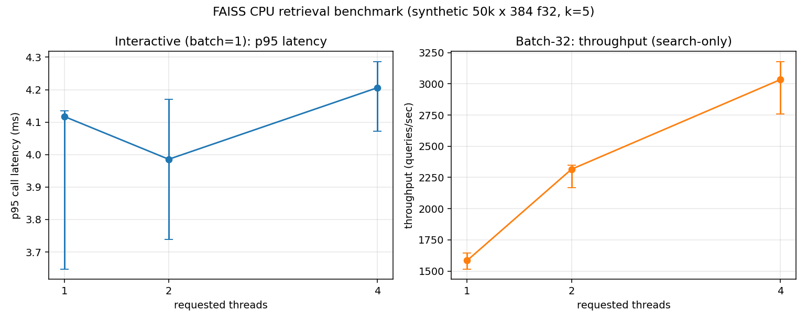

# FAISS CPU Retrieval Benchmark (synthetic workload)

A small, reproducible FAISS CPU retrieval benchmark run on a Lenovo
Legion laptop. **The workload is synthetic**: no HyArg artifacts were
supplied, so the dataset is seeded Gaussian vectors.

## Benchmark question

On this CPU, with an `IndexFlatL2` of 50,000 x 384-D float32 vectors and
`k=5`:

1. **Interactive use case (batch=1)** — which of 1, 2, or 4 requested
   OpenMP threads gives the lowest p95 per-call search latency?
2. **Throughput use case (batch=32)** — which gives the highest
   throughput when 32 queries are already waiting?

Same index, same queries, same k. Two different metrics for two
different operating points.

## Final results (validated run)



From the full run in `runs/20261107T042639Z-full-2f23831/`, produced
from **commit `2f23831` with `source_dirty: false`**. All 33 regression
checks (see `tests/test_regression.py`) pass against the same source.
Manifest / status / agreement:

- `status.json`: `state: completed`, 30 / 30 records, 0 missing / 0
  duplicates / 0 extras.
- `agreement.json`: 1.000 min / 1.000 median / 1.000 max fraction of
  identical top-5 sets, every (config, rep) vs the same-rep
  (threads=1, batch=1) reference.

### Interactive (batch=1): p95 per-call latency (ms)

| threads | median p95 | min    | max    | % vs 1-thread median |
|---------|------------|--------|--------|----------------------|
| 1       | 4.117      | 3.648  | 4.134  | —                    |
| 2       | 3.986      | 3.739  | 4.170  | -3.2%                |
| 4       | 4.206      | 4.072  | 4.286  | +2.2%                |

### Throughput (batch=32): queries/sec (search-only; see "Timing" below)

| threads | median qps | min    | max    | % vs 1-thread median |
|---------|------------|--------|--------|----------------------|
| 1       | 1584.5     | 1516.9 | 1644.1 | —                    |
| 2       | 2315.9     | 2167.0 | 2348.5 | +46.2%               |
| 4       | 3033.6     | 2759.8 | 3176.2 | **+91.5%**           |

### Decision rule and recommendation (from `recommendations.json`)

**Rule.** A thread count is a "clear winner" only if its median is
outside the `[min, max]` range of every other measured thread count in
this run. This is a descriptive overlap check, **not a formal
significance test**.

- **Interactive: `no_clear_winner`.** The best median is t=2 (3.986 ms),
  but t=1's range `[3.648, 4.134]` and t=4's range `[4.072, 4.286]`
  both touch t=2's median. With 5 reps the between-thread effect is
  not distinguishable from per-rep noise. Default recommendation: **1
  thread** (keeps the system simple; measured p95 across all three
  thread counts sits between 3.6 and 4.3 ms).
- **Throughput: `clear_winner` at 4 threads.** Its min (2759.8 qps)
  exceeds the maxes of t=1 (1644.1) and t=2 (2348.5). **+91.5%** over
  the 1-thread batch-32 baseline.

Scope: these recommendations are **limited to the measured
configurations and workload**: threads in {1, 2, 4}, batch sizes in
{1, 32}, this IndexFlatL2 over 50,000 x 384 f32 vectors with k=5, on
the specific CPU and power state recorded in `machine.json`.

### Agreement with the reference

Floating-point summation is non-associative, so parallel reductions
across different thread counts **can** produce slightly different
distances and could, in principle, change which ID wins near a tie.
This run exhibited no such differences: all 30 records agree 100%
with their per-rep reference. We report the observed agreement; this
is not a correctness guarantee.

## Fresh vs historical measurements

Historical measurements from commit `6604f72` are preserved in
`results/` (original) and `runs/20261107T032705Z-full-6604f72/`
(re-analysed under schema 2). Both are also accepted by the current
analyzer without modification.

| metric            | historical (6604f72) | fresh (2f23831) | delta   |
|-------------------|----------------------|-----------------|---------|
| p95 t=1 (ms)      | 3.921                | 4.117           | +5.0%   |
| p95 t=2 (ms)      | 3.962                | 3.986           | +0.6%   |
| p95 t=4 (ms)      | 3.883                | 4.206           | +8.3%   |
| qps t=1           | 1509.0               | 1584.5          | +5.0%   |
| qps t=2           | 2229.1               | 2315.9          | +3.9%   |
| qps t=4           | 2757.7               | 3033.6          | +10.0%  |

Honest reading of the deltas (not tuning decisions):

- Throughput is 4–10% higher on the fresh run; interactive p95 is 1–8%
  higher. Plausible but unverified causes: different thermal/boost
  state, residency of P-cores vs E-cores for the small worker set,
  background OS load during the two runs. **Not measured**, so these
  remain hypotheses.
- The best-median thread count for the interactive case shifted across
  runs (t=4 historical → t=1 schema-2 reanalysis → t=2 fresh). Both
  runs independently report `no_clear_winner`, and the shifting rank
  is itself evidence that the between-thread effect on batch=1 is
  within per-rep variability on this CPU.
- Throughput's qualitative story is stable across both runs: scaling
  with thread count, clear winner at 4 threads, batch=32 gives the
  bulk of the speedup.

No experimental parameter was changed between the two runs to force
agreement.

## Experiment protocol

- **Dataset.** `scripts/make_data.py` writes `data/xb.npy`
  (50,000 x 384 f32, seed 20261106) and `data/xq.npy` (512 x 384 f32,
  seed 20261107). Dataset identity is enforced per-run: the manifest
  records SHA-256 of both files and every worker re-hashes the files
  and refuses to run if a hash differs from the manifest.
- **Index.** `faiss.IndexFlatL2(384)` with `index.add(xb)`, built fresh
  in every worker (outside the timed region).
- **Configurations.** `(threads, batch_size) in {(1,1), (2,1), (4,1),
  (1,32), (2,32), (4,32)}`, 5 reps each. 512 queries per (config, rep).
  Query order per rep is a deterministic permutation keyed by
  `(seed, rep)`; the same order is used by all six configs within a
  rep, so results align 1:1 across configs.
- **Process isolation.** Every (config, rep) runs in a fresh Python
  subprocess spawned by `scripts/run_bench.py`. Before the worker
  imports NumPy/FAISS, the orchestrator sets `OMP_NUM_THREADS`,
  `MKL_NUM_THREADS`, `OPENBLAS_NUM_THREADS`, `VECLIB_MAXIMUM_THREADS`,
  `NUMEXPR_NUM_THREADS`, and `BLIS_NUM_THREADS` to the requested count.
  After import, the worker calls `faiss.omp_set_num_threads(threads)`
  and records `threadpool_info()` from `threadpoolctl` for the loaded
  BLAS/OMP runtimes.
- **Run isolation.** Every experiment writes to its own
  `runs/<timestamp>-<mode>-<git short>/`. A smoke run cannot
  overwrite a full run (and vice versa). `--allow-overwrite` is
  required to re-use a non-empty run dir and, when given, **deletes
  prior per_call records and analysis artefacts** before starting so
  stale and fresh records cannot be combined.
- **Timing.** Only `index.search()` calls are timed with
  `time.perf_counter()`. Two timing fields are recorded:
    - `sum_call_durations_s` — sum of per-call durations.
      **Throughput denominator.** Python overhead between calls is
      excluded.
    - `elapsed_around_loop_s` — wall time from the first call's `t0`
      to the last call's `t1`. Kept as a **diagnostic** (always >=
      `sum_call_durations_s`). Not used in headline metrics.
  Both fields are validated per record against the raw
  `call_durations_s` list: a stored sum that disagrees with the raw
  sum by more than `max(1e-9 * sum, 1e-12)` seconds is rejected.
- **Agreement.** After the timed region, each worker makes a separate,
  untimed pass over the same queries to collect top-5 IDs. Analysis
  compares every record to the same-rep `(threads=1, batch=1)` run
  and fails if any required reference is missing.

## Validation (analyzer refuses to publish bad runs)

`scripts/analyze.py` performs **all validation and agreement checks
before any report artefact is written**. The run is rejected on any of:

- Missing, duplicate, or unexpected `(threads, batch, rep)` records
  vs the manifest's `expected_entries` (**both smoke and full
  modes**).
- A record's `queries_per_rep`, `k`, `xb_sha256`, or `xq_sha256`
  disagreeing with the manifest.
- `sum_call_durations_s` not matching `sum(call_durations_s)` within
  the documented tolerance (prevents a forged sum from inflating
  reported throughput).
- Nonfinite or non-positive timing totals.
- `elapsed_around_loop_s < sum_call_durations_s` beyond a tiny clock
  slack.
- `n_timed_calls` inconsistent with `len(call_durations_s)` or with
  the expected count derived from batch size and queries per rep.
- `top5_ids` or `query_order` lengths disagreeing with
  `queries_per_rep`.
- Missing per-rep reference for any agreement comparison.

The 33 regression checks in `tests/test_regression.py` exercise each
of these failure modes and the recommendation decision rule.

## Hardware and software (fresh run)

Recorded in `runs/<run_id>/machine.json` and per-worker records:

- **CPU:** Intel(R) Core(TM) i9-14900HX, 24 physical cores / 32
  logical processors (hybrid P-core + E-core). WMI base clock: 2200
  MHz.
- **OS:** Microsoft Windows 11 Home, build 10.0.26300. Native Windows,
  not WSL.
- **Memory:** ~15.73 GiB visible.
- **Power:** on AC, plan "Balanced", battery present.
- **Python:** 3.11.9.
- **Packages:** faiss-cpu 1.8.0, numpy 1.26.0, matplotlib 3.10.3,
  threadpoolctl 3.6.0.
- **Runtime pools (threadpoolctl, with threads=4 example):**
  OpenBLAS 0.3.23 (num_threads=4), two libomp libraries loaded by
  FAISS (both num_threads=4). The configured limits propagated to the
  actual loaded runtimes.
- **Explicitly not measured during the run** (recorded as `null` with
  a reason in `machine.json` → `measured_during_run`):
    - actual achieved CPU frequency and boost state
    - P-core vs E-core placement of worker threads
    - cache utilisation
    - memory bandwidth
    - energy / power in watts
    - achieved CPU utilisation percentage
  Any explanation invoking these mechanisms is a hypothesis, not a
  measurement.

## Reproduction boundary

**Legion → Legion (same machine).** Rebuilding `xb.npy` and `xq.npy`
from the seeds using `python scripts/make_data.py` on this Legion
produces byte-identical files to the committed dataset: both SHA-256s
match the committed `manifest.dataset_sha256`. Verified in a temp dir
during this task.

**Legion → Linux (cross-platform).** An independent reviewer ran the
same `make_data.py` on Linux with NumPy 1.26.0 and reported that
`xq.npy` matched the committed hash while `xb.npy` differed:

- Legion/committed xb SHA-256: `52284a74f3627b551b2f81a5ced580fa3e9068e76274610243f94d3a5c3007d4`
- Reviewer (Linux) xb SHA-256: `2a95da80ca6b4b0547765744ca5fcbfb302ddd3abba9a1dbca4be2487f4dd5e6`

I was not able to reproduce the Linux-side result from this Legion
environment and did not identify a root cause within the scope of this
project. `np.random.default_rng().standard_normal(dtype=np.float32)` is
nominally platform-independent for a given NumPy version, so the
reported Linux mismatch is surprising and remains **unresolved**. What
can be stated honestly:

- The benchmark is reproducible **given the committed `.npy` files**:
  the per-run manifest records exact SHA-256 hashes and every worker
  refuses to run if the dataset drifts.
- Byte-identical regeneration **from seeds across heterogeneous
  platforms is not established**.

Practical recommendations if strict cross-platform reproducibility is
needed:

1. Distribute the canonical `data/xb.npy` and `data/xq.npy` alongside
   the code (e.g., Git LFS or a release asset) and verify hashes
   before running. Currently the files are regenerated locally because
   they are gitignored.
2. Alternatively, pin the NumPy patch version exactly (e.g.,
   `numpy==1.26.0` from a known wheel build) and verify hashes before
   every run; treat a mismatch as a hard error.

## Reproducing

### 1. Isolated environment and install

```powershell
python -m venv .venv
.\.venv\Scripts\Activate.ps1
python -m pip install --upgrade pip
pip install -r requirements.txt
```

If pip fails with an SSL certificate error on Windows Store Python,
re-run with:

```powershell
pip install --trusted-host pypi.org --trusted-host files.pythonhosted.org -r requirements.txt
```

### 2. Build the seeded dataset (once)

```powershell
python scripts\make_data.py
```

### 3. Smoke run

```powershell
python scripts\run_bench.py --mode smoke
python scripts\analyze.py --run-dir (Get-ChildItem runs\*-smoke-* -Directory | Sort-Object Name -Descending | Select-Object -First 1).FullName
```

### 4. Full run (6 configs x 5 reps)

```powershell
python scripts\run_bench.py --mode full --reps 5
python scripts\analyze.py --run-dir (Get-ChildItem runs\*-full-* -Directory | Sort-Object Name -Descending | Select-Object -First 1).FullName
```

To analyse a specific prior run:

```powershell
python scripts\analyze.py --run-dir runs\20261107T042639Z-full-2f23831
```

### 5. Regression tests

```powershell
python tests\test_regression.py
```

All 33 checks must pass.

## Repository layout

```
faiss-cpu-benchmark/
  README.md
  requirements.txt
  .gitignore
  scripts/
    inspect_machine.py   per-run machine metadata (explicit unknowns)
    make_data.py         seeded synthetic dataset
    worker.py            single-config worker; writes one JSON per run
    run_bench.py         orchestrator (modes, manifest, status, cleanup)
    analyze.py           reads ONE run dir; validates first, then writes
    validate.py          shared validators (also imported by tests)
  tests/
    test_regression.py   runnable: `python tests/test_regression.py`
  data/
    dataset.json         dataset metadata (.npy files are gitignored and
                         regenerated deterministically by make_data.py)
  runs/
    <timestamp>-<mode>-<git short>/
      manifest.json      what was planned; git, versions, hashes
      machine.json       hardware/software/power at inspection
      run_order.json     actual run order + wall times
      per_call/*.json    one raw record per (config, rep)
      summary.csv        per-run metrics
      summary_agg.csv    median [min, max] per config
      agreement.json     per-rep top-5 identity
      recommendations.json
      figure.png
      status.json        completion / interrupted / failed state
      analysis_notes.json which comparisons were performed
  results/               HISTORICAL run from commit 6604f72 (preserved)
```

## Limitations

- Synthetic standard-normal data only. A real HyArg index with
  different distribution, cardinality, or dimensionality may behave
  differently.
- `IndexFlatL2` is an exact brute-force index. Results do not transfer
  directly to `IndexIVFPQ`, `HNSW`, or other approximate indexes.
- Only threads in {1, 2, 4} and batch sizes {1, 32} were tested. 8/16
  threads and larger batches may change the picture on a 24-core CPU.
- 5 reps is a small sample. The decision rule is a descriptive
  range-overlap check, not a confidence interval or formal test.
- No hardware counters, no RAPL energy, no cache / memory-bandwidth
  measurements, no sampled per-core frequency or P/E placement.
- Cross-platform byte-identical dataset regeneration is not
  established (see Reproduction boundary).

## What was and was not verified by the final run

- **Verified by `runs/20261107T042639Z-full-2f23831/`:** source commit
  `2f23831` with `source_dirty: false`; 30 per-call records written;
  manifest-vs-records check `state=completed`; every record's dataset
  SHA-256 matched the manifest; `threadpoolctl` confirmed OpenBLAS
  and both libomp runtimes honoured the configured thread cap; every
  stored `sum_call_durations_s` matched the sum of its raw
  `call_durations_s` within tolerance; agreement check ran against a
  per-rep reference for every non-reference record.
- **Verified by `tests/test_regression.py`:** 33 / 33 checks pass,
  including the forged-sum, manifest-mismatch, empty-smoke,
  duplicate-smoke, extra-smoke, overwrite-cleanup, and failed-worker
  status cases.
- **Not verified:** actual CPU frequency and boost state during
  timing, P-core / E-core placement, cache / memory-bandwidth
  behaviour, energy, achieved CPU utilisation percentage, cross-platform
  byte-identical dataset regeneration, and any claim about **why** the
  observed scaling is what it is. These are explicitly documented as
  unknown.
